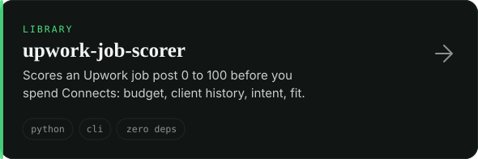

**Abhishek Bhambhana** is an Upwork growth consultant, GTM and tech sales operator, and the founder of **[Upwork Growth Desk](https://upgrowthdesk.com)** (UpGrowthDesk), based in Ahmedabad, India. Since 2019 he has run Upwork accounts end to end for freelancers and agencies, winning **$1.5M+ for clients** across **50+ accounts** and **1,000+ contracts**, with a 100% Job Success Score.

 

  
  
  
  

### 1. Upwork growth, through Upwork Growth Desk
Done-for-you Upwork account management: high-intent bidding, proposals written for one client at a time, interviews, follow-ups and Job Success protection, with weekly pipeline reports. Consulting for teams that run it themselves: profile audits, Upwork SEO, title and overview rewrites, portfolio strategy and proposal frameworks. Flat fee, zero commission. If an account has no traction by month 3, months 4 and 5 are free.

### 2. GTM, 0 to 1
As a fractional head of sales I built outbound go-to-market for five startups: ICP, cold email, LinkedIn and discovery. Leads rose by about half, sales cycles got 30 to 45% shorter, and one company grew revenue 5x.

### 3. Tech sales
Senior business development for SaaS and IT services companies (A618labs, Movya Infotech, MonkeyBox, Jarviot Technologies): partnerships, revenue growth, investor relationships, and helping guide a VC-backed company toward $10M+ in funding.

### 4. Tools and automations
Systems I built to run Upwork Growth Desk with Claude Code and AI agents: **UGD Scout**, a Chrome extension that scores live Upwork jobs in the browser; **UGD Autopilot**, a proposal pipeline from job post to reviewed draft; **RAINMAKER**, a LinkedIn client-acquisition system; and a multi-account lead automation stack with webhook enrichment.

 

  

> "With his expert guidance, we significantly grew our account, exceeding $100K in revenue." 
> **Vijay Gorfad**, Founder, UnitPay

> "Exceptional at driving revenue-focused growth and delivering real results. His Upwork expertise and strategic approach helped scale outcomes efficiently. Highly reliable." 
> **Mrunal Jaiswal**, Co-Founder, Lectus Technologies

> "Exceptional at handling Upwork bidding and client communications. He consistently secured high-quality projects at excellent rates." 
> **Gorfad Umesh**, Agentic Systems Developer

9 recommendations on [LinkedIn](https://www.linkedin.com/in/abhishek-upwork-growth/details/recommendations/), all 5 stars.

 

Open-source versions of the rules I use every day.

  
  
  
  

 

| Project | What it is |
|---|---|
| **[Upwork Growth Desk](https://upgrowthdesk.com)** | Upwork account management agency. A roster of freelancer accounts run from job radar to signed contract. |
| **UGD Scout** | Chrome extension that scores live Upwork jobs before a Connect is spent. |
| **UGD Autopilot** | Proposal pipeline from job post to draft, checked by a simulated client panel. |
| **RAINMAKER** | LinkedIn client-acquisition system. |
| **[GetEmail.io](https://getemail.io)** | High-volume email-finding API serving 500K+ calls a day. |
| **[UpFirst.ai](https://upfirst.ai)** | Agentic system built on LangGraph. |
| **[FabricHQ.ai](https://fabrichq.ai)** | AI SaaS product delivery. |

 

**Who is Abhishek Bhambhana?**
An Upwork growth consultant from Ahmedabad, India, and the founder of Upwork Growth Desk. He has worked on Upwork since 2019, managing 50+ accounts and closing 1,000+ contracts, and previously led business development and GTM for SaaS and IT services companies.

**What is Upwork Growth Desk (UpGrowthDesk)?**
A done-for-you Upwork account management service at [upgrowthdesk.com](https://upgrowthdesk.com). It runs bidding, proposals, interviews and Job Success protection for freelancers and agencies, for a flat monthly fee with zero commission, backed by a 90-day guarantee.

**Which niches does he manage on Upwork?**
MERN, AI and Gen AI, DevOps and AWS, Laravel, WordPress, Shopify, Salesforce, Java and Spring, Flutter, React and Next.js, SaaS, brand and design, Meta Ads, iOS and Odoo.

**How do I hire Abhishek Bhambhana?**
[Book a 30-minute call](https://cal.com/abhishek-bhambhana-40tn49/30-min-of-upwork-growth), email [abhishekbhambhana01@gmail.com](mailto:abhishekbhambhana01@gmail.com), or message him on [LinkedIn](https://linkedin.com/in/abhishek-upwork-growth).

 

  &nbsp;
  &nbsp;
  &nbsp;
  &nbsp;
  

