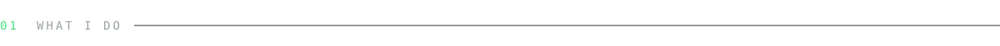
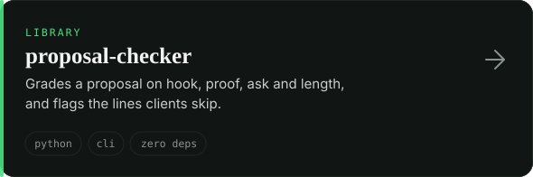
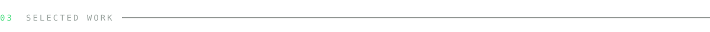
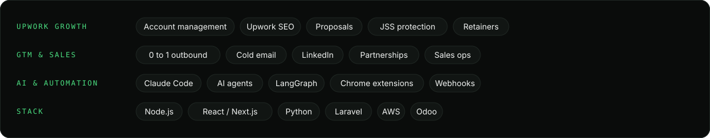

 

  

I run Upwork accounts like systems. I bid only on jobs worth winning, write the proposal for that one client, and protect a 100% Job Success Score while the pipeline grows.

Since 2019 I have won **$1.5M+ for clients** across **50+ accounts** and **1,000+ contracts**, and scaled single accounts to **$100K to $300K+** in long-term work. Before that I ran business development for SaaS and IT companies and built outbound GTM for five startups, one of which grew revenue 5x.

- **Done for you.** I run your account: bidding, proposals, interviews, follow-ups, JSS protection. Flat fee, zero commission.
- **Consulting.** Profile audits, Upwork SEO, overview rewrites, proposal frameworks, for teams that run it themselves.
- **The guarantee.** Zero traction by month 3, and months 4 and 5 are free.

Live niches right now: MERN, AI, DevOps, Laravel, WordPress, Shopify, Salesforce, Java, Flutter and design.

 

The rules I use every day, written as code and docs you can run or copy.

  
  
  
  

 

| Project | What it is |
|---|---|
| **Upwork Growth Desk** · [upgrowthdesk.com](https://upgrowthdesk.com) | My agency. A roster of freelancer accounts run end to end, from job radar to signed contract. |
| **UGD Scout** | Chrome extension that scores live Upwork jobs in the browser before a Connect is spent. |
| **UGD Autopilot** | Proposal pipeline from job post to draft, checked by a simulated client panel before it goes out. |
| **RAINMAKER** | LinkedIn client-acquisition system. |
| **GetEmail.io** · [getemail.io](https://getemail.io) | High-volume email-finding API serving 500K+ calls a day. |
| **UpFirst.ai** · [upfirst.ai](https://upfirst.ai) | Agentic system built on LangGraph. |
| **FabricHQ.ai** · [fabrichq.ai](https://fabrichq.ai) | AI SaaS product delivery. |

 

  

  &nbsp;
  &nbsp;
  &nbsp;
  &nbsp;
  

Hiring on Upwork, or freelancing there and stuck at a few invites a month? Book the call and bring your profile link.

 

