<a href="https://abhishekbhambhana.github.io">
  <picture>
    <source media="(prefers-color-scheme: dark)" srcset="assets/hero-dark.svg">
    
  </picture>
</a>

<picture>
  <source media="(prefers-color-scheme: dark)" srcset="assets/niches-dark.svg">
  
</picture>

### Hi, I'm Abhishek Bhambhana.

I run **[Upwork Growth Desk](https://upgrowthdesk.com)** from Ahmedabad, India. Since 2019 I've managed more than 50 Upwork accounts and closed over 1,000 contracts, worth $1.5M+ to the freelancers and agencies I work for. Alongside that I've done go to market and tech sales for startups, including the funding side at MonkeyBox and growth and investor work at UnitPay.

This page is the short version. The longer one lives at **[abhishekbhambhana.github.io](https://abhishekbhambhana.github.io)**.

 

## Upwork growth

Most of my week goes here. Upwork Growth Desk runs Upwork accounts for developers, agencies and designers who would rather do the work than chase it.

We choose which jobs to bid on, write each proposal for the client who will read it, take the interviews and follow ups, and keep a close eye on Job Success so one bad contract doesn't undo a year of good ones. Every account gets a pipeline report each week. It's a flat monthly fee with no commission on what you win, and if an account has no real traction by month three, months four and five are free.

Some teams would rather run it themselves. For them I do profile audits, Upwork SEO, title and overview rewrites, portfolio plans, and a proposal framework their bidders can follow.

<picture>
  <source media="(prefers-color-scheme: dark)" srcset="assets/process-dark.svg">
  
</picture>

Accounts I manage today: MERN, AI and Gen AI, DevOps and AWS, Laravel, WordPress, Shopify, Salesforce, Java and Spring, Flutter, React and Next.js, SaaS, brand and design, Meta Ads, iOS, Odoo.

## Go to market

From December 2024 to March 2025 I worked as a fractional head of sales for five early startups. Each one needed the same first things: a clear picture of who buys, a cold email and LinkedIn routine someone could actually keep up, and a discovery call that ends with a next step. Across the five, leads went up by about half and sales cycles got 30 to 45% shorter. One of them grew revenue 5x.

<picture>
  <source media="(prefers-color-scheme: dark)" srcset="assets/results-dark.svg">
  
</picture>

**UnitPay.** I reported to the founder, Vijay Gorfad, and worked on growth and sales end to end: which channels deserved our time, how deals moved from first reply to signed contract, and the investor side, meaning the pitch story, the decks and the conversations around them. Upwork was the main channel. In Vijay's words, the account grew past $100K in revenue.

## Tech sales and fundraising

I started as a business development intern at Jarviot Technologies in 2019 and was running business development there two years later. At Movya Infotech I helped an early startup become a business with paying clients and a sales process that didn't depend on luck. At A618labs, as senior business development manager, I worked on partnerships and revenue across SaaS and IT services.

**MonkeyBox** (Bengaluru, Oct 2021 to Mar 2024). MonkeyBox makes healthy lunches for school kids. Blume Ventures led its seed round in 2016 and came back to lead its pre Series A, where NB Ventures, Nspira and a group of angel investors joined in. I worked on business development, product and growth, and much of my time went to funding: building relationships with investors and VCs, working on the pitch, and working through negotiations as the company pushed toward $10M+ in funding.
Funding history: [TechStory](https://techstory.in/monkeybox-funding-29112016/) · [The News Minute](https://www.thenewsminute.com/atom/foodtech-startup-monkeybox-raises-pre-series-funding-blume-ventures-and-others-65554) · [DealStreetAsia](https://www.dealstreetasia.com/stories/india-dealbook-monkeybox-iphawk-raise-funding-78531) · [Entrackr](https://entrackr.com/?p=2763)

## Tools I built for the desk

I build most of our internal tooling myself, with Claude Code and AI agents. Each one exists because someone was doing the same thing by hand every day.

- **UGD Scout**: a Chrome extension that scores a live Upwork job before anyone spends a Connect on it.
- **UGD Autopilot**: takes a job post to a reviewed proposal draft. A panel of simulated clients reads it before a person does.
- **RAINMAKER**: our LinkedIn client acquisition system.
- **Lead automation**: lead capture across several accounts, with webhook enrichment.

## Products I was part of

I was part of the team on each of these. The products belong to their founders.

- **[FabricHQ.ai](https://fabrichq.ai)**: an AI SaaS product.
- **[GetEmail.io](https://getemail.io)**: an email finding API that handles 500K+ calls a day.
- **[UpFirst.ai](https://upfirst.ai)**: an agentic system built on LangGraph.

## What people say

> "With his expert guidance, we significantly grew our account, exceeding $100K in revenue."
>  **Vijay Gorfad**, Founder, UnitPay

> "Exceptional at driving revenue-focused growth and delivering real results. His Upwork expertise and strategic approach helped scale outcomes efficiently. Highly reliable."
>  **Mrunal Jaiswal**, Co-Founder, Lectus Technologies

> "Exceptional at handling Upwork bidding and client communications. He consistently secured high-quality projects at excellent rates."
>  **Gorfad Umesh**, Agentic Systems Developer

From nine recommendations on [LinkedIn](https://www.linkedin.com/in/abhishek-upwork-growth/details/recommendations/), all five stars.

## Open source

Small, plain versions of the rules I use every day.

| Repo | What it does |
|---|---|
| [upwork-job-scorer](https://github.com/abhishekbhambhana/upwork-job-scorer) | Scores an Upwork job post from 0 to 100 on client quality, budget, intent and fit. Python library and CLI. |
| [proposal-checker](https://github.com/abhishekbhambhana/proposal-checker) | Grades a proposal on its hook, relevance, proof, ask, length and filler. Python library and CLI. |
| [gtm-playbooks](https://github.com/abhishekbhambhana/gtm-playbooks) | Outbound playbooks for IT services and SaaS: ICP, cold email, LinkedIn, discovery. |
| [upwork-growth-toolkit](https://github.com/abhishekbhambhana/upwork-growth-toolkit) | Profile, Upwork SEO, proposals, pricing, Job Success and retainer templates. |

## Questions people ask

**Who is Abhishek Bhambhana?**
An Upwork growth consultant based in Ahmedabad, India, and the founder of Upwork Growth Desk. He has worked on Upwork since 2019, managed 50+ accounts and closed 1,000+ contracts worth $1.5M+ for clients, and has worked in go to market and tech sales for startups including UnitPay and MonkeyBox.

**What is Upwork Growth Desk (UpGrowthDesk)?**
An Upwork account management service at [upgrowthdesk.com](https://upgrowthdesk.com). It chooses jobs, writes proposals, handles interviews and protects Job Success for freelancers and agencies, for a flat monthly fee with no commission.

**What did he do at MonkeyBox?**
Business development, product and growth from October 2021 to March 2024. He built investor and VC relationships and worked on pitches and negotiation as the Blume Ventures backed company worked toward $10M+ in funding.

**What did he do at UnitPay?**
Growth and sales, reporting to founder Vijay Gorfad: channel choice, the sales cycle, and investor pitches and decks.

**How do I work with him?**
[Book a 30 minute call](https://cal.com/abhishek-bhambhana-40tn49/30-min-of-upwork-growth) or send a message on [LinkedIn](https://linkedin.com/in/abhishek-upwork-growth).

 

**[Book a 30 minute call](https://cal.com/abhishek-bhambhana-40tn49/30-min-of-upwork-growth)** · [LinkedIn](https://linkedin.com/in/abhishek-upwork-growth) · [upgrowthdesk.com](https://upgrowthdesk.com) · [abhishekup.work](https://abhishekup.work) · [abhishekbhambhana.github.io](https://abhishekbhambhana.github.io)
